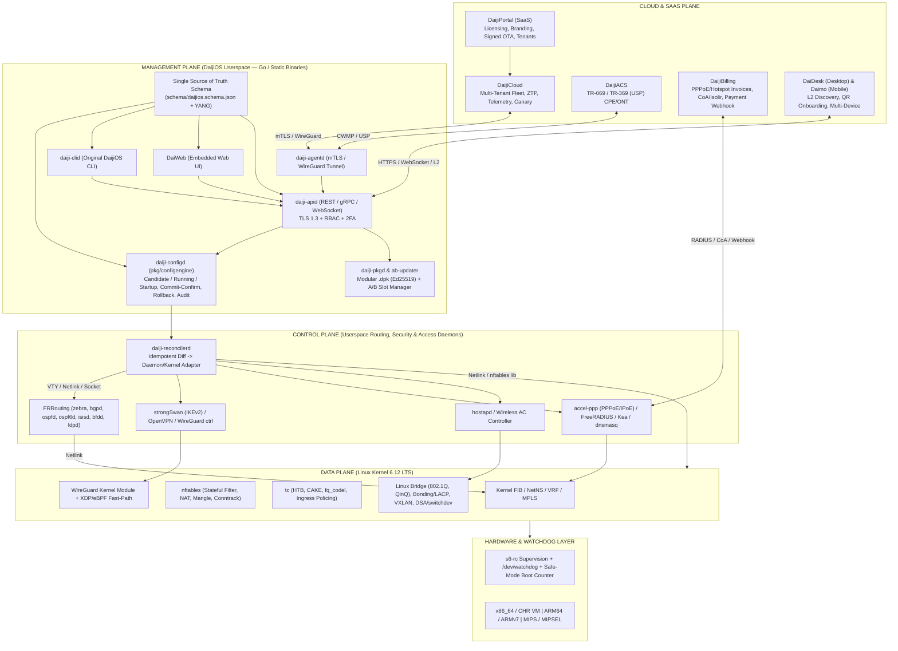

# DaijiOS — Arsitektur & Fondasi (FASE 0)

> **Identitas Resmi:** `DaijiOS — Ecosystem by kangpcode (Dhafa Nazula Permadi)`

Dokumen ini menetapkan fondasi arsitektur Network Operating System (NOS) **DaijiOS** dan seluruh Ekosistem Daiji (`DaijiOS`, `DaiWeb`, `Daimo`, `DaiDesk`, `DaijiCloud`, `DaijiACS`, `DaijiBilling`, `DaijiPortal`) pada Fase 0.

---

## 1. Diagram Arsitektur 4-Plane Ekosistem Daiji



### Tampilan ASCII Ringkas (Terminal-Friendly)

```
+------------------------------------------------------------------------------+
| CLOUD PLANE:  DaijiPortal | DaijiCloud | DaijiACS | DaijiBilling | Daimo/Desk |
+------------------------------------+-----------------------------------------+
                                     | mTLS / WireGuard / HTTPS / TR-069
+------------------------------------v-----------------------------------------+
| MGMT PLANE:   [SSoT Schema (JSON Schema + YANG)]                             |
|               daiji-clid | DaiWeb | daiji-apid ---> daiji-configd / pkgd     |
+------------------------------------+-----------------------------------------+
                                     | Idempotent Plan/Apply + Diff
+------------------------------------v-----------------------------------------+
| CTRL PLANE:   daiji-reconcilerd -> FRR | strongSwan | Kea | FreeRADIUS | hostapd
+------------------------------------+-----------------------------------------+
                                     | Netlink / Sockets / Netfilter
+------------------------------------v-----------------------------------------+
| DATA PLANE:   Linux 6.12 LTS Kernel (FIB/VRF, nftables, tc CAKE/HTB,         |
|               802.1Q/QinQ Bridge, LACP, WireGuard, DSA/switchdev, XDP/eBPF)  |
+------------------------------------+-----------------------------------------+
| HAL/WATCHDOG: s6-rc + /dev/watchdog + A/B Bootloader (GRUB2 / U-Boot)        |
+------------------------------------------------------------------------------+
```

---

## 2. Pemilihan Basis OS & Justifikasi Teknis

### 2.1 Kernel & Userspace Base
| Lapisan | Pilihan DaijiOS | Alasan Teknis & Operasional |
| :--- | :--- | :--- |
| **Kernel** | **Linux Kernel 6.12 LTS** | Dukungan hardware terluas (NIC Intel/Mellanox/Realtek, ARM SoC, switch DSA MIPS/ARM), stack `nftables`, `tc CAKE/HTB`, `WireGuard`, `VRF`, `MPLS`, serta akselerasi eBPF/XDP tanpa ketergantungan vendor tunggal. |
| **C Library** | **musl libc** (MIT) | Jejak memori sangat kecil (cocok untuk router MIPS/ARM 64–128 MB RAM sekaligus ringan di x86_64), perilaku statis deterministik, dan bebas lisensi viral LGPL untuk linking statis. |
| **Init & Supervisor** | **s6 + s6-rc** (ISC) | Boot cepat (<3 detik di x86/CHR), footprint ratusan KB, process supervision berbasis pipe/event tanpa polling, terintegrasi langsung dengan hardware watchdog `/dev/watchdog`. |
| **Control/Mgmt Daemons** | **Go 1.27 (Static Binary, `CGO_ENABLED=0`)** | Kompilasi silang native untuk `amd64`, `arm64`, `armv7`, `mipsel` (`GOMIPS=softfloat`), concurrency aman untuk ribuan sesi PPPoE/ACS/WebSocket, dan bebas dependency DLL/SO di rootfs A/B read-only. |
| **RootFS Format** | **SquashFS (Read-Only A/B) + Overlay/Data RW** | Mencegah korupsi rootfs saat mati listrik mendadak; seluruh OS inti bersifat immutable pada Slot A / Slot B, sedangkan konfigurasi dan paket tersimpan di partisi `/data` yang transaksional. |

### 2.2 Mengapa Bukan FreeBSD atau DPDK-Only?
- **Vs FreeBSD:** Ekosistem driver CPE/AP/Switch DSA murah (MediaTek MT7621, Filogic, Realtek RTL838x, Rockchip) dan fitur Wi-Fi 802.11ax/be (`mac80211`/`hostapd`) jauh lebih matang di Linux.
- **Vs DPDK-Only:** DPDK mengikat core CPU 100% dalam poll-mode dan memutus integrasi standar `switchdev`, Wi-Fi `mac80211`, serta `tc`/WireGuard kernel. DaijiOS memilih **Linux Kernel Data Plane + XDP/eBPF fast-path opsional** agar berjalan mulus dari CPE 1-core hingga router ISP multi-100GbE.

---

## 3. Matriks Target Hardware & Image CHR

| Target | Arsitektur Go | Bootloader | Format RootFS / Image | Contoh Perangkat / Platform |
| :--- | :--- | :--- | :--- | :--- |
| **x86_64 Appliance** | `linux/amd64` | GRUB2 (UEFI + BIOS) | SquashFS A/B + GPT `/data` | Server 1U/2U, Intel N100/Xeon/EPYC, NIC i225/ixgbe/ice/mlx5 |
| **DaijiOS CHR (VM/Cloud)** | `linux/amd64` / `arm64` | GRUB2 | `qcow2`, `vmdk`, `vhdx`, `raw`, `iso` | KVM/Proxmox, VMware ESXi, Hyper-V, AWS/GCP/Cloud-init |
| **ARM64 Enterprise/Edge** | `linux/arm64` | U-Boot / EFI | FIT uImage + SquashFS A/B | MediaTek Filogic 830/880, Rockchip RK3568/3588, Marvell OcteonTX, RPi CM4/5 |
| **ARMv7 Branch/AP** | `linux/arm` (`GOARM=7`) | U-Boot | FIT uImage + SquashFS A/B | IPQ40xx/IPQ60xx, Armada 385 |
| **MIPS / MIPSEL CPE/Switch** | `linux/mipsle` (`GOMIPS=softfloat`) | U-Boot | SquashFS + UBI/UBIFS A/B | MediaTek MT7621, Qualcomm QCA95xx, Realtek RTL838x DSA |

---

## 4. Strategi Single Source of Truth (SSoT)

Seluruh antarmuka (`daiji-clid`, `DaiWeb`, `Daimo`, `DaiDesk`, `REST/OpenAPI`, dan `NETCONF/YANG`) mengonsumsi **satu definisi skema kanonik** (`schema/daijios.schema.json` + pemetaan `schema/yang/daiji-system@2026-11-17.yang`):
- Setiap field memiliki anotasi `x-daiji-cli`, `x-daiji-ui`, `x-daiji-rbac`, `x-daiji-impact` (`none`, `hot-reload`, `service-restart`, `reboot`), dan `x-daiji-secret`.
- Penandaan `x-daiji-secret: true` otomatis memicu redaksi `***REDACTED***` pada output `diff`, pembacaan API non-superadmin, dan catatan `audit.jsonl`.
