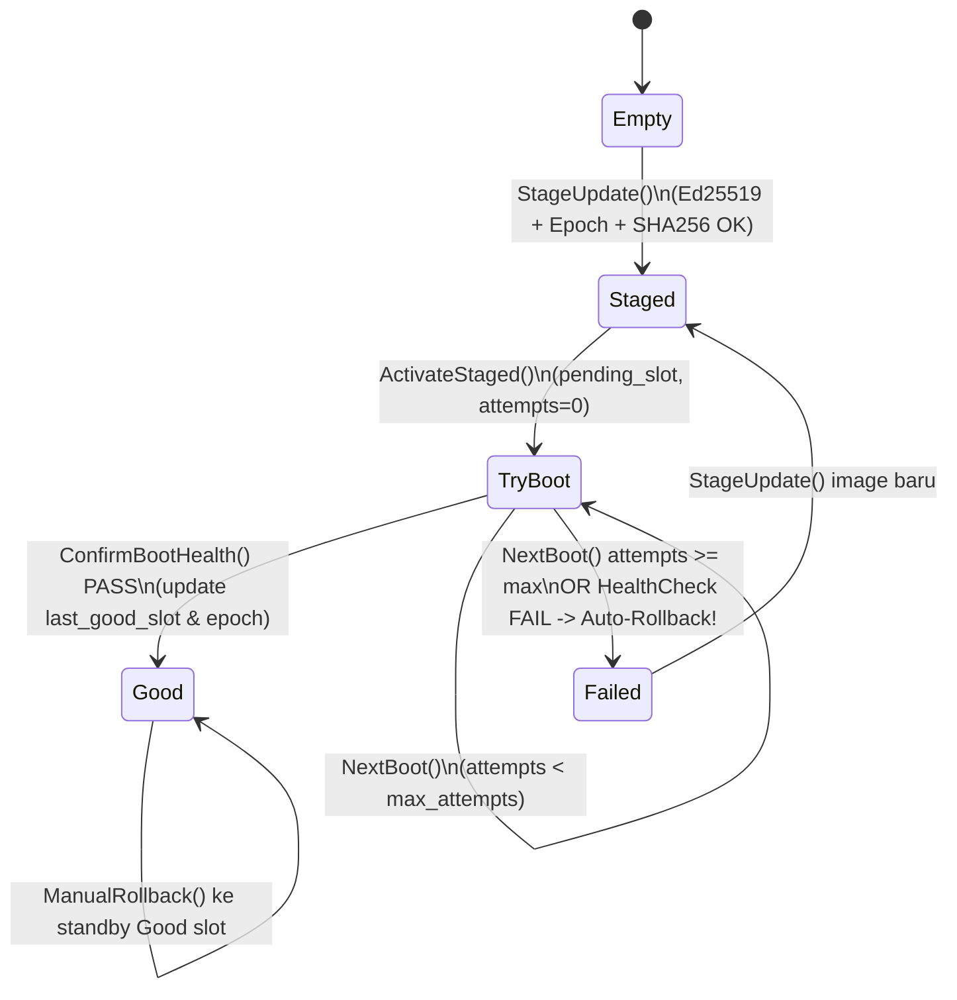

# Desain Sistem Paket Modular (`.dpk`) & Update Sistem A/B

## 1. Sistem Paket Modular (`.dpk` — `pkg/pkgmgr`)

DaijiOS memisahkan kernel/core OS yang ramping dari fitur lanjutan melalui paket modular `.dpk`:
- **Tier Paket:** `core` (essential), `routing` (FRR), `security` (nftables/WireGuard/strongSwan), `isp` (PPPoE/Hotspot/FreeRADIUS), `wireless` (hostapd/AC), `management` (DaiWeb/Agent/ACS).
- **Verifikasi Kriptografis:** Setiap manifest `.dpk` ditandatangani dengan **Ed25519** dan memiliki `payload_sha256`. Verifikasi memeriksa kunci tepercaya (`KeyID`), tanda tangan, hash payload, kompatibilitas arsitektur (`x86_64`, `arm64`, `armv7`, `mipsel`, `all`), serta proteksi **anti path-traversal** pada daftar file.
- **Dependency Solver:** Resolusi topologis DFS dengan deteksi siklus (`ErrDependencyCycle`), pemeriksaan konflik dua arah (`Conflicts`), evaluasi constraint SemVer (`>=`, `<=`, `=`, `>`, `<`), proteksi paket `Essential: true`, serta penolakan hapus jika masih menjadi dependensi paket lain (`ErrReverseDependency`).

## 2. Tata Letak Partisi & State Machine Update A/B (`pkg/abupdate`)

```
+-------------------------------------------------------------------+
| /boot/efi + Bootloader Env (GRUB2 env / U-Boot env)               |
+-------------------------------------------------------------------+
| Slot A (SquashFS Read-Only: Kernel + Initramfs + RootFS)          |
+-------------------------------------------------------------------+
| Slot B (SquashFS Read-Only: Kernel + Initramfs + RootFS)          |
+-------------------------------------------------------------------+
| /data (RW Persistent: Configs, Revisions, Audit, .dpk, Logs, Keys)|
+-------------------------------------------------------------------+
```



### Perlindungan Keamanan Firmware
- **Anti-Downgrade (`security_epoch`)**: Firmware dengan `security_epoch` lebih rendah daripada epoch aktif perangkat otomatis ditolak (`ErrDowngradeBlocked`) untuk mencegah serangan rollback ke versi yang memiliki CVE kritis.
- **Zero-Downtime Write**: `StageUpdate()` selalu menulis secara streaming (`io.TeeReader` -> `SHA-256`) hanya ke **slot tidak aktif**, sehingga sistem yang sedang berjalan tidak pernah terganggu atau korup jika listrik padam saat download/flash.
